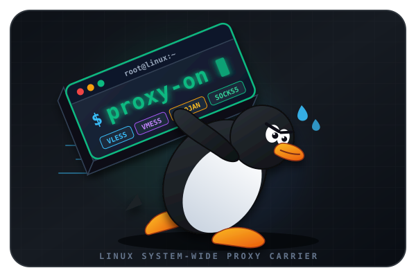

<div dir="rtl">

<p align="center">
  
</p>

<h1 align="center">⚡ Linux-Proxy-on ⚡</h1>

<p align="center">
  <b>ابزار سریع، سبک و همه‌کاره خط فرمان لینوکس برای مدیریت و ست کردن انواع پروکسی (VLESS, VMess, Trojan, Shadowsocks, SOCKS4/5, HTTP) روی کل سیستم</b>
</p>

<p align="center">
  <a href="README.md"><b>English</b></a> • 
  <a href="#-معرفی-پروژه">ویژگی‌ها</a> • 
  <a href="#-شروع-سریع">نصب سریع</a> • 
  <a href="#%EF%B8%8F-دستورات-و-نحوه-استفاده">دستورات</a> • 
  <a href="#-معماری-و-نحوه-عملکرد">معماری</a>
</p>

<p align="center">
  
  
  
  
  
</p>

---

## 📌 معرفی پروژه

راه‌اندازی پروتکل‌های مدرن پروکسی (مانند VLESS-Reality، VMess یا Trojan) روی سرورهای لینوکسی و محیط‌های ترمینال (بدون رابط گرافیکی)، معمولاً نیازمند ویرایش فایل‌های پیچیده JSON و تعریف دستی متغیرهای محیطی است. **Linux-Proxy-on** این مشکل را با یک معماری ترکیبی و هوشمند حل می‌کند:
- **مبدل هوشمند لینک (`parser.py`):** لینک‌های استاندارد اشتراک‌گذاری (`vless://`, `vmess://`, `ss://`, `socks5://` و...) را دریافت کرده و به‌صورت خودکار به فایل کانفیگ استاندارد JSON تبدیل می‌کند.
- **هسته قدرتمند (`Xray-core`):** در پس‌زمینه لینوکس به عنوان یک سرویس `systemd` اجرا شده و یک پورت محلی یکپارچه برای SOCKS5 (`10808`) و HTTP (`10809`) ایجاد می‌کند.
- **توابع بومی Bash:** بدون نیاز به بستن و باز کردن ترمینال، تنظیمات پروکسی را در همان لحظه روی شِل فعلی، پروفایل سراسری سیستم و پکیج منیجر `apt` اعمال می‌کند.

---

## ✨ ویژگی‌های کلیدی

| ویژگی | توضیحات |
| :--- | :--- |
| **🌐 پشتیبانی از انواع پروتکل‌ها** | پشتیبانی کامل از `VLESS` (Reality/TLS/WS/gRPC)، `VMess`، `Trojan`، `Shadowsocks`، `SOCKS4/5` و `HTTP/HTTPS`. |
| **⚡ فعال‌سازی آنی در ترمینال** | اعمال مستقیم متغیرهای `http_proxy` و `all_proxy` روی ترمینال فعلی بدون نیاز به ری‌استارت کردن شِل. |
| **📦 تنظیم خودکار APT** | پیکربندی خودکار پروکسی برای پکیج منیجر `apt` جهت دانلود و نصب بدون تحریم و فیلتر پکیج‌ها. |
| **🔗 دریافت مستقیم لینک کانفیگ** | تبدیل مستقیم لینک‌های کپی‌شده به کانفیگ هسته بدون نیاز به ویرایش دستی فایل‌های JSON. |
| **📊 نمایش وضعیت و IP خروجی** | بررسی وضعیت سرویس، نمایش پروتکل فعال و استعلام آنی IP و کشور سرور خروجی. |
| **📡 تست پینگ واقعی (HTTP 204)** | اندازه‌گیری تاخیر واقعی اتصال از داخل تانل رمزنگاری‌شده پروکسی بر حسب میلی‌ثانیه (`ms`). |
| **🛡️ ایمن برای اتصال SSH** | هدایت ترافیک خروجی بدون ایجاد اختلال یا قطعی در اتصال SSH فعلی شما به سرور مجازی (VPS). |
| **🛠️ مدیریت سرویس با Systemd** | اجرای پایدار در پس‌زمینه به همراه قابلیت روشن شدن خودکار در زمان بوت سرور. |

---

<details>
<summary>📸 مشاهده نمونه محیط ترمینال (کلیک کنید)</summary>

<br>

<div dir="ltr">

```text
$ proxy-config "vless://uuid@example.com:443?security=reality&sni=yahoo.com&fp=chrome&pbk=xxx&type=tcp#Germany-VPS"
[✓] کانفیگ با موفقیت ثبت شد! (VLESS -> example.com:443)

$ proxy-on
[✓] پروکسی روی کل سیستم فعال شد (HTTP: 10809 | SOCKS5: 10808).

$ proxy-ping
[*] در حال تست پینگ به سرور example.com:443 ...
[✓] پینگ واقعی پروکسی (HTTP 204): 142 ms

$ proxy-status
========================================
وضعیت سرویس : فعال (Active)
پروتکل فعلی : VLESS (example.com:443)
در حال بررسی IP خروجی از طریق پروکسی...
آی‌پی خروجی  : 185.x.x.x (DE - Hetzner Online GmbH)
========================================
```

</div>

</details>

---

## 🚀 شروع سریع

### پیش‌نیازها
- **سیستم‌عامل:** Ubuntu 20.04+ / Debian 11+ / Fedora / Arch Linux (`amd64` / `arm64`)
- **دسترسی:** کاربر `root` یا دسترسی `sudo`

### نصب خودکار
اسکریپت نصب خودکار را اجرا کنید. این دستور تمام پیش‌نیازها (`curl`, `jq`, `python3`, `unzip`) را نصب کرده، آخرین نسخه `Xray-core` متناسب با پردازنده شما را دانلود می‌کند و دستورات را به ترمینال اضافه می‌نماید:

<div dir="ltr">

```bash
bash <(curl -Ls https://raw.githubusercontent.com/amirh-ti/Linux-Proxy-on/main/install.sh) && source /etc/profile.d/cli-proxy.sh
```

</div>

### حذف برنامه
برای حذف کامل Linux-Proxy-on (شامل سرویس systemd، هسته Xray و تنظیمات محیطی)، دستور زیر را اجرا کنید:

<div dir="ltr">

```bash
bash <(curl -Ls https://raw.githubusercontent.com/amirh-ti/Linux-Proxy-on/main/uninstall.sh)
```

</div>

---

## ⌨️ دستورات و نحوه استفاده

پس از نصب، می‌توانید در هر محیط ترمینالی با استفاده از این **۶ دستور اصلی** پروکسی سیستم را مدیریت کنید:

| دستور | کاربرد |
| :--- | :--- |
| `proxy-on` | روشن کردن سرویس پس‌زمینه و ست کردن پروکسی روی کل سیستم و پکیج منیجر APT. |
| `proxy-off` | خاموش کردن سرویس و پاکسازی کامل تنظیمات پروکسی از ترمینال و سیستم. |
| `proxy-config` | ثبت و جایگزینی لینک کانفیگ جدید (به‌صورت مستقیم یا تعاملی). |
| `proxy-status` | نمایش وضعیت سرویس، پروتکل فعال و نمایش IP و کشور خروجی سیستم. |
| `proxy-ping` | تست اتصال و دریافت پینگ واقعی (بر حسب میلی‌ثانیه) از داخل تانل پروکسی. |
| `proxy-types` | نمایش لیست پروتکل‌های قابل پشتیبانی به همراه فرمت استاندارد هر لینک. |

### مثال‌های کاربردی

<div dir="ltr">

```bash
# ثبت مستقیم لینک کانفیگ جدید
proxy-config "vless://uuid@server:443?security=tls&type=ws#MyProxy"

# یا ثبت به صورت تعاملی (برنامه لینک را از شما می‌پرسد)
proxy-config

# تست پینگ و سلامت کانفیگ قبل از روشن کردن روی سیستم
proxy-ping

# روشن کردن پروکسی روی کل سیستم
proxy-on

# بررسی وضعیت اتصال و مشاهده IP جدید سرور
proxy-status

# خاموش کردن پروکسی و بازگشت به اینترنت مستقیم
proxy-off
```

</div>

---

## 🌐 پروتکل‌های پشتیبانی‌شده

در هر زمان با اجرای دستور `proxy-types` می‌توانید فرمت‌های استاندارد را در ترمینال مشاهده کنید:

<div dir="ltr">

```text
1. VLESS (TCP / WS / gRPC / TLS / Reality)
   vless://uuid@ip:port?type=ws&security=tls&sni=domain.com#name

2. VMess (Standard Base64 URI)
   vmess://eyJ2IjoiMiIsInBzIjoi...

3. Trojan (TLS / WS / TCP)
   trojan://password@domain.com:443?security=tls&sni=domain.com#name

4. Shadowsocks (SS)
   ss://base64(method:password)@ip:port#name

5. SOCKS5 (With or Without Auth)
   socks5://user:pass@ip:port  or  socks5://ip:port

6. SOCKS4
   socks4://ip:port

7. HTTP / HTTPS
   http://user:pass@ip:port    or  http://ip:port
```

</div>

---

## 🛠️ مدیریت سرویس پس‌زمینه

علاوه بر دستورات `proxy-on` و `proxy-off`، می‌توانید سرویس هسته را مستقیماً با `systemctl` بررسی و مدیریت کنید:

<div dir="ltr">

```bash
# بررسی وضعیت سرویس پس‌زمینه
sudo systemctl status cli-proxy.service

# مشاهده لاگ‌های زنده هسته Xray برای عیب‌یابی
sudo journalctl -u cli-proxy.service -f

# ری‌استارت دستی سرویس
sudo systemctl restart cli-proxy.service
```

</div>

---

## 🔄 معماری و نحوه عملکرد

<div dir="ltr">

```text
               ┌──────────────────────────────┐
               │      User Terminal CLI       │
               │   proxy-config "<uri_link>"  │
               └──────────────┬───────────────┘
                              │
                              ▼
               ┌──────────────────────────────┐
               │          parser.py           │
               │   Decodes URI & Generates    │
               │   /opt/cli-proxy/config.json │
               └──────────────┬───────────────┘
                              │
                              ▼
               ┌──────────────────────────────┐
               │     Xray-core (Systemd)      │
               │  Establishes Remote Tunnel   │
               └──────────────┬───────────────┘
                              │
               ┌──────────────┴───────────────┐
               ▼                              ▼
┌─────────────────────────────┐┌─────────────────────────────┐
│  Local SOCKS5 (Port 10808)  ││   Local HTTP (Port 10809)   │
└──────────────┬──────────────┘└──────────────┬──────────────┘
               │                              │
               └──────────────┬───────────────┘
                              │ Runs `proxy-on`
                              ▼
               ┌──────────────────────────────┐
               │   System-Wide Integration    │
               │  • Active Shell Env Vars     │
               │  • /etc/profile.d/ Globals   │
               │  • APT Package Manager Conf  │
               └──────────────────────────────┘
```

</div>

---

## 📁 ساختار پروژه

<div dir="ltr">

```text
Linux-Proxy-on/
├── install.sh                 # اسکریپت نصب خودکار و ساخت سرویس systemd
├── uninstall.sh               # اسکریپت حذف کامل برنامه و پاکسازی تنظیمات
├── parser.py                  # ماژول پایتون برای تبدیل لینک پروکسی به JSON
├── proxy-functions.sh         # دستورات ۶گانه Bash در ترمینال
│
├── media/                     # فایل‌های گرافیکی مستندات
│   └── logo.svg               # لوگوی پروژه
│
├── README.md                  # مستندات انگلیسی
└── README.fa.md               # مستندات فارسی
```

</div>

---


## 🤝 مشارکت و حمایت

از مشارکت شما در توسعه پروژه، ثبت گزارش باگ‌ها و ارائه پیشنهادات استقبال می‌کنیم!

۱. پروژه را **Fork** کنید.  
۲. یک برنچ جدید بسازید (`git checkout -b feature/AmazingFeature`).  
۳. تغییرات خود را **Commit** کنید (`git commit -m 'Add some AmazingFeature'`).  
۴. برنچ را **Push** کنید (`git push origin feature/AmazingFeature`).  
۵. یک **Pull Request** ثبت کنید.  

اگر پروژه **Linux-Proxy-on** برایتان مفید بود، لطفاً با دادن یک **⭐ Star** در گیت‌هاب از آن حمایت کنید!

---

## 📜 قدردانی

این پروژه با کمک ابزارهای متن‌باز زیر ساخته شده است:
- [Xray-core](https://github.com/XTLS/Xray-core)
- [jq](https://jqlang.github.io/jq/)
- [Python 3](https://www.python.org/)

</div>
